# Rapport de synthèse : application de messagerie instantanée

Module : ADDA75, API et Web Services  
Formation : Master Ingénierie Informatique  
Auteurs :  
- Loqmann Benhaddya (Binôme B : Messages, Persistance & Temps Réel WebSocket)  
- Samy Azdad (Binôme A : Identité, Sécurité JWT & API REST)  

---

## 1. Objectif et périmètre

Le projet fait dialoguer en temps réel un client « bureau » et un client « mobile » par l'intermédiaire d'un serveur central que nous avons écrit. Les deux appareils ne se parlent jamais directement : le serveur reçoit chaque message, l'enregistre, puis le renvoie au destinataire.

| Exigence de l'énoncé (§6) | Réalisation |
| :--- | :--- |
| Création de compte et authentification JWT | `POST /api/comptes`, `POST /api/auth/login` (bcrypt, JWT HS256) |
| Messages temps réel entre deux clients distincts | Canal `/ws/messages`, clients `desktop/` et `mobile/` |
| Persistance de tous les messages | Table `messages` (SQLite) |
| Historique via l'API REST | `GET /api/messages/{utilisateurId}` |
| Endpoints sensibles protégés par JWT | `get_current_user`, qui renvoie `401 Unauthorized` |

Nous avons aussi réalisé les cinq bonus : accusé de réception à trois états (`envoye`, `livre`, `lu`), indicateur de saisie, notification hors ligne par webhook simulé, limitation de débit et documentation Swagger.

---

## 2. Architecture

### 2.1. Vue d'ensemble

```text
Appareil A : client bureau                  Appareil B : client mobile
(navigateur sur ordinateur)                 (navigateur sur téléphone)
       │                                                   │
       │   HTTP REST : comptes, login, présence, historique│
       │   WebSocket : messages, accusés, saisie           │
       │                                                   │
       └─────────────────────────┬─────────────────────────┘
                                 │
                     SERVEUR CENTRAL (FastAPI / uvicorn)
                     ├── users/     comptes, liste + présence
                     ├── auth/      bcrypt, JWT, get_current_user
                     ├── messages/  modèle, service, historique REST
                     ├── realtime/  ConnectionManager, /ws/messages, webhook simulé
                     └── core/      configuration, BDD, erreurs, rate limiting
                                 │
                     BASE DE DONNÉES (SQLite)
                     ├── users     (id, username unique, password_hash)
                     └── messages  (id, expediteur_id, destinataire_id, contenu,
                                    date_envoi, statut)
```

Le serveur sert aussi les deux clients (`/clients/desktop/`, `/clients/mobile/`) : ils sont chargés depuis la même origine que l'API, donc rien à configurer sur le téléphone.

Quand A envoie un message sur son WebSocket, le serveur valide la trame (Pydantic, 1 à 5000 caractères, limite anti-spam, destinataire existant), puis déduit l'`expediteurId` du JWT et fixe lui-même la `dateEnvoi`, en UTC : un client ne peut ni usurper un autre utilisateur ni antidater un message. Il enregistre le message, le retransmet à B s'il est connecté, et renvoie à A un accusé (`ack`). Quand B affiche la conversation, son client envoie `read` et A reçoit un `read_ack`.

### 2.2. Répartition entre REST et WebSocket

Les opérations ponctuelles passent en REST : création de compte et login, liste des utilisateurs avec leur présence (`GET /api/utilisateurs`) et historique (`GET /api/messages/{utilisateurId}`). Les messages, accusés et indicateurs de saisie passent par le WebSocket `/ws/messages?token=<JWT>`.

Le polling ne convient pas aux messages. Si B interroge le serveur à intervalle court, presque toutes les requêtes reviennent vides ; à intervalle long, le message arrive en retard. Le WebSocket est une connexion persistante et bidirectionnelle, ouverte une fois par un handshake HTTP (`101 Switching Protocols`, vu au TP4), et le serveur peut y pousser un message vers B dès qu'il le reçoit de A. La présence est la seule donnée que nous rafraîchissons par polling (toutes les 5 secondes et à chaque message reçu) : un point vert en retard de quelques secondes ne gêne personne.

### 2.3. Question : pourquoi l'historique est-il exposé en REST plutôt qu'en WebSocket ?

Un historique est une ressource au sens REST (Chapitre 4) : `GET /api/messages/2` désigne « ma conversation avec l'utilisateur 2 ». Cette forme apporte ce qu'un WebSocket n'offre pas.

Elle a une URL. N'importe quel outil HTTP (navigateur, curl, Postman, Bruno) peut la demander, et Swagger la documente, alors qu'OpenAPI n'a pas d'équivalent standard pour un échange WebSocket. `GET` ne modifie rien : on peut le rejouer sans risque après une coupure réseau, et notre client le fait à chaque reconnexion pour rattraper ce qu'il a manqué. Sur un WebSocket, il faudrait inventer un message « demande d'historique » et relier chaque réponse à sa demande.

Une réponse `GET` peut aussi être mise en cache (`Cache-Control`, `ETag`, `304 Not Modified`), ce que les trames WebSocket ne permettent pas. Nous n'avons pas activé le cache, parce que la réponse contient le statut de lecture des messages, qui évolue. Enfin, chaque requête REST porte son JWT et se suffit à elle-même : n'importe quelle instance du serveur peut y répondre, alors qu'une connexion WebSocket est attachée à un processus (§5).

À l'inverse, le WebSocket ne transporte que ce qui se passe pendant que la connexion est ouverte. S'il était la seule source de l'historique, un client déconnecté perdrait tout ce qui s'est dit en son absence, comme nous l'avons observé au TP4 avec le service d'écho de Postman.

---

## 3. Sécurité

Les mots de passe sont hachés avec bcrypt (sel aléatoire, coût volontairement élevé) et n'apparaissent jamais dans une réponse ni dans les logs.

Au login, le serveur émet un JWT HS256 (`sub`, `iat`, `exp` à 60 minutes), signé avec un secret lu dans `.env`. En REST, `get_current_user` lit l'en-tête `Authorization: Bearer` et renvoie `401 Unauthorized` si le jeton est absent, falsifié ou expiré. Nous levons l'erreur nous-mêmes (`HTTPBearer(auto_error=False)`), parce que selon les versions FastAPI renvoie `403` alors que l'énoncé exige `401`.

Les navigateurs ne permettent pas d'ajouter un en-tête au handshake WebSocket, donc le jeton passe en paramètre (`/ws/messages?token=...`) et le serveur le vérifie avant d'enregistrer la connexion. S'il est invalide, il accepte puis ferme avec le code 1008 : refuser avant d'accepter ne donnerait au navigateur qu'un code 1006 sans motif, alors que 1008 lui permet de renvoyer l'utilisateur à l'écran de connexion. Un jeton en paramètre d'URL apparaît toutefois dans les logs d'accès ; en production, on utiliserait un jeton à usage unique ou un cookie `HttpOnly`.

Le reste est classique : limitation de débit en fenêtre glissante (10 messages par 10 secondes sur le WebSocket, 5 tentatives de login par minute, puis `429` avec `Retry-After`), validation Pydantic de tout le JSON, requêtes SQL paramétrées, affichage des messages par `textContent` pour éviter le XSS, erreurs REST au format `{"detail", "code"}`. Nous n'avons pas mis HTTPS en place pour la démonstration, qui tourne sur un réseau local. En production, un reverse proxy terminerait TLS (HTTPS et WSS), puisque le mot de passe et le JWT circulent dans les requêtes.

---

## 4. Question : que faire si le destinataire n'est pas connecté ?

Le message ne doit pas être perdu. Le serveur enregistre d'abord, livre ensuite :

1. Il enregistre le message avec le statut `envoye`. L'expéditeur reçoit un `ack` et son client affiche « Envoyé » : le message est stocké, pas encore remis.
2. Il déclenche un webhook vers un service de notifications, simulé par un log (`Webhook simulé : notification envoyée à l'utilisateur 2 ...`), sur le modèle du TP4. Dans une vraie application, ce service enverrait une notification push au téléphone.
3. Quand le destinataire se connecte, le serveur passe ses messages en attente à `livre` et envoie un `delivered_ack` à chaque expéditeur connecté : « Distribué » chez A.
4. Le client du destinataire recharge la conversation par `GET /api/messages/{id}`, y compris les messages reçus en son absence, puis envoie `read` : A voit « Lu ».

<p align="center">
  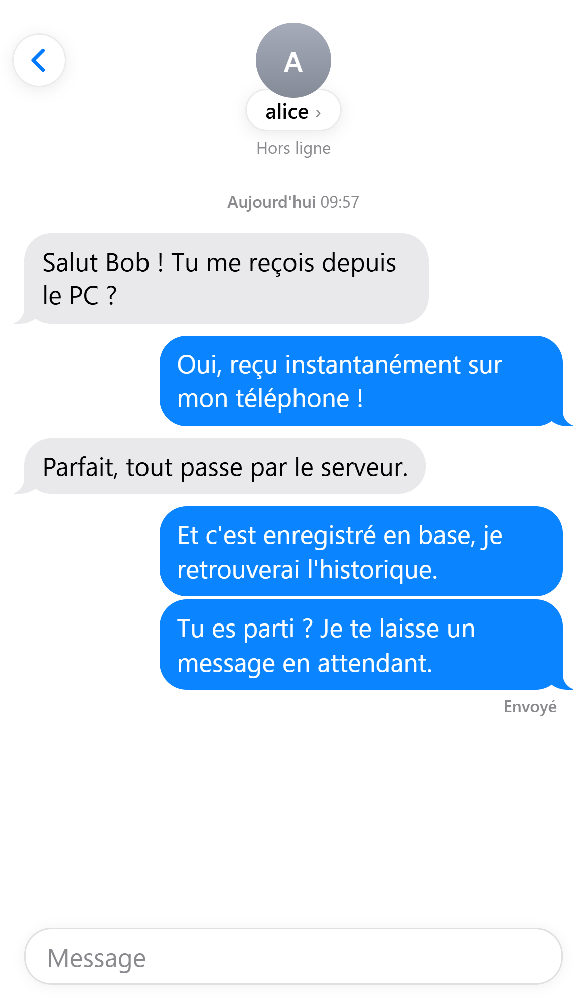
  
  
</p>

*Figure 1 : côté expéditeur (bob, mobile). Alice est hors ligne et le message reste « Envoyé ». À sa reconnexion, il passe à « Distribué », puis à « Lu » quand elle rouvre la conversation.*

<p align="center">
  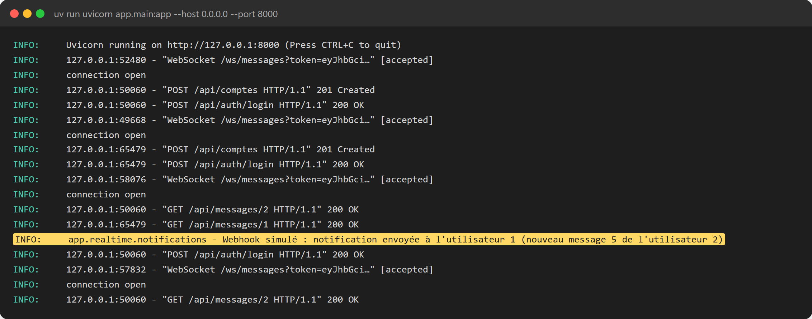
</p>

*Figure 2 : console du serveur pendant le même scénario, avec le webhook simulé déclenché par le message envoyé à alice hors ligne. Les jetons JWT présents dans l'URL du WebSocket sont tronqués.*

Le parallèle avec Kafka (Chapitre 6) tient à la persistance. Kafka écrit les événements dans un journal durable, et un consommateur déconnecté reprend à son `offset` quand il revient. Notre table `messages` joue ce rôle de journal : le WebSocket ne sert qu'à gagner en latence, la base reste la source de vérité, et le statut `envoye` / `livre` tient lieu d'offset par destinataire. Un WebSocket seul perdrait le message, et une file AMQP classique le supprimerait à l'acquittement, alors que notre table le conserve et permet de le relire par `GET`.

Une différence demeure : Kafka garantit la remise, notre envoi WebSocket se fait au mieux. Si la connexion de B meurt entre l'enregistrement et l'envoi, le message est marqué `livre` sans avoir été affiché, mais B le retrouvera dans l'historique. Une garantie plus forte exigerait un accusé explicite du client avant de passer à `livre`.

---

## 5. Choix techniques et difficultés

Nous avons choisi Python 3.13 et FastAPI, qui fournit REST, WebSocket, validation Pydantic et OpenAPI dans un seul serveur (l'énoncé laisse le choix du backend). La base est un fichier SQLite accédé par SQLAlchemy 2.0 : l'équivalent de H2 que l'énoncé accepte, et un fichier plutôt qu'une base en mémoire pour que l'historique survive à un redémarrage. L'API parle JSON en camelCase (`expediteurId`, `dateEnvoi` sont imposés par l'énoncé), avec des dates UTC générées par le serveur. Les clients sont en HTML et JavaScript sans framework, et partagent `common/api.js` (REST et WebSocket) et `common/chat.js` (logique d'interface).

Trois difficultés ont pesé sur le travail.

L'état est en mémoire. Le `ConnectionManager` garde les connexions dans un dictionnaire Python, comme les compteurs anti-spam. Avec plusieurs workers uvicorn, si A est connecté au worker 1 et B au worker 2, le worker 1 croit B hors ligne. Nous lançons donc un seul worker, ce qui suffit pour la démonstration. Pour passer à l'échelle, il faudrait un bus partagé (Redis Pub/Sub).

L'ORM est synchrone dans un serveur asynchrone. Un `db.commit()` appelé directement dans le handler `async def` bloquerait la boucle d'événements, donc tous les utilisateurs. Tous les accès à la base depuis le WebSocket passent par `run_in_threadpool`.

Le scénario réel a révélé quatre défauts que `TestClient` ne montrait pas. Chacun est couvert par un test depuis :

- Après une reconnexion rapide d'un téléphone, la fermeture tardive de l'ancienne socket retirait du registre la nouvelle. `disconnect` ne retire désormais l'entrée que si c'est la même socket.
- SQLite ne vérifie pas les clés étrangères : un message vers un utilisateur inexistant était stocké. Le serveur répond maintenant `DESTINATAIRE_INCONNU`.
- Une trame qui n'était pas du JSON coupait la connexion. Nous décodons le texte nous-mêmes et renvoyons `JSON_INVALIDE`.
- Le refus d'authentification émis avant `accept()` apparaissait comme un 1008 dans les tests, mais comme un simple échec de handshake dans un vrai navigateur (voir §3).

Sur mobile, une perte de réseau ne produit pas toujours de trame de fermeture. Quand une écriture échoue, le serveur retire l'utilisateur du registre, et le client se reconnecte après 3 secondes puis recharge l'historique.

---

## 6. Validation et démonstration

Le serveur est couvert par 43 tests pytest (REST et WebSocket : `401`, JWT, accusés, hors ligne, anti-spam, trames invalides), et la collection Bruno compte 11 requêtes, 12 tests et 15 assertions, toutes au vert.

Nous avons rejoué le scénario de l'énoncé (§2.1) sur deux PC distincts connectés au même Wi-Fi. Le premier exécute le serveur (`uvicorn --host 0.0.0.0`) et le client bureau ; le second ouvre le client mobile à l'adresse IP du premier. Chaque client voit l'autre « En ligne », un message de A apparaît instantanément chez B et inversement, et après la déconnexion puis la reconnexion de A, l'historique complet est rechargé.

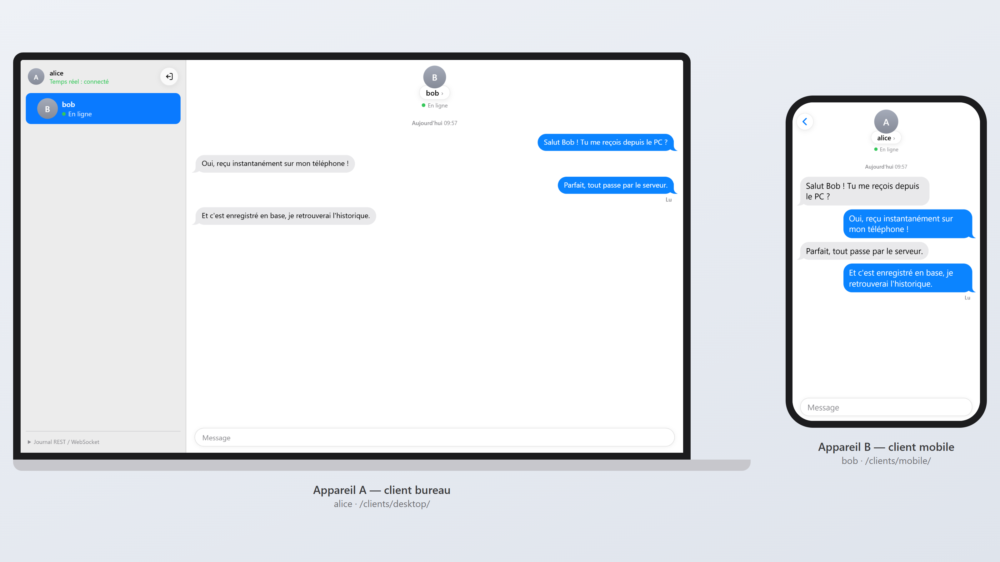

*Figure 3 : la même conversation sur le client bureau (alice, à gauche) et sur le client mobile (bob, à droite). Chaque message envoyé par l'un apparaît chez l'autre, et le dernier message envoyé de chaque côté est marqué « Lu ».*

Les captures sont produites en rejouant le scénario avec Playwright contre le serveur réel, avec deux sessions de navigateur indépendantes : une fenêtre de bureau (1280 × 760) pour A et un gabarit de téléphone (iPhone 13) pour B. Les autres captures du scénario sont en annexe.

## 7. Limites

Il reste à mettre en place HTTPS/WSS derrière un reverse proxy, le passage à plusieurs instances avec Redis Pub/Sub, la pagination de l'historique avec un cache `ETag`, plusieurs connexions simultanées pour un même compte (aujourd'hui, la plus récente remplace la précédente), une présence poussée en WebSocket, et un refresh token pour ne pas se reconnecter au bout d'une heure.

---

## Annexe : captures du scénario

<p align="center">
  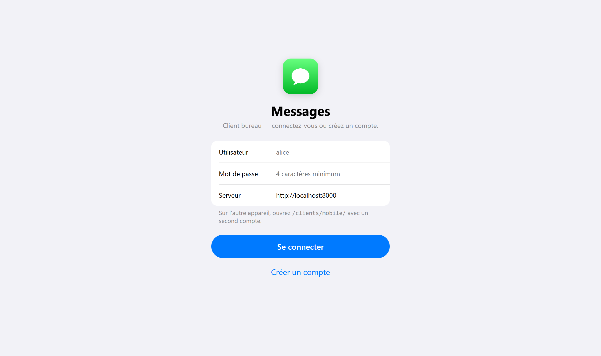
  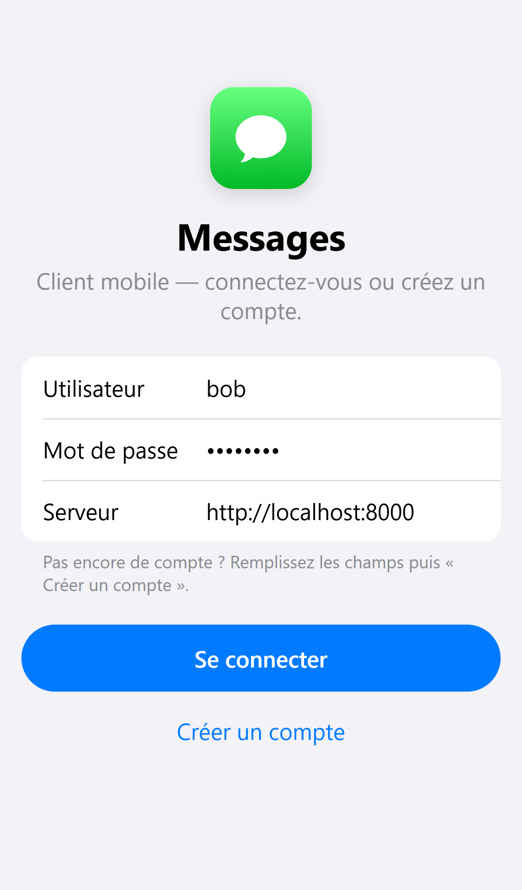
</p>

*Figure 4 : écrans de connexion. Le même formulaire sert à se connecter (`POST /api/auth/login`) et à créer un compte (`POST /api/comptes`, puis login). Le champ « Serveur » est prérempli avec l'origine de la page, servie par FastAPI.*

<p align="center">
  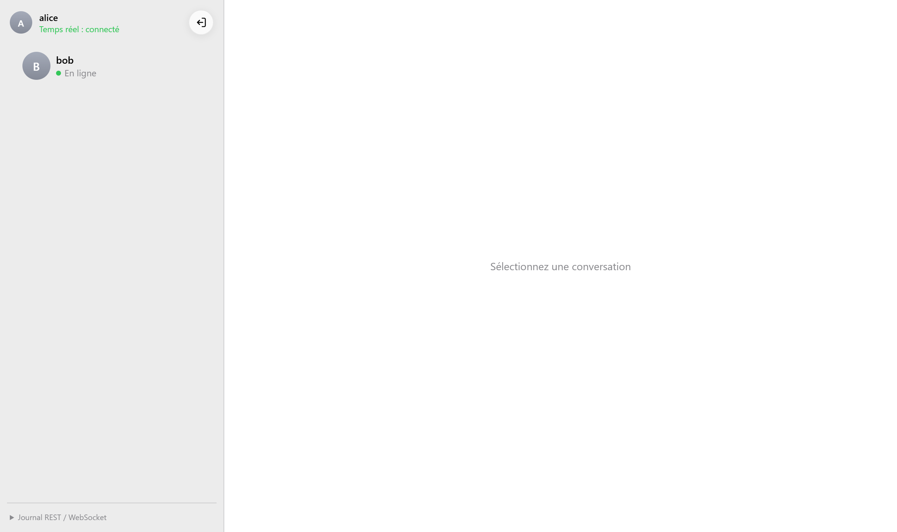
  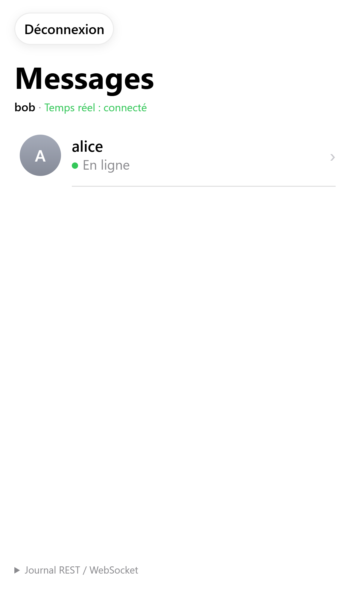
</p>

*Figure 5 : présence (`GET /api/utilisateurs`, champ `connecte`). Chacun voit l'autre « En ligne », avec le point vert.*

<p align="center">
  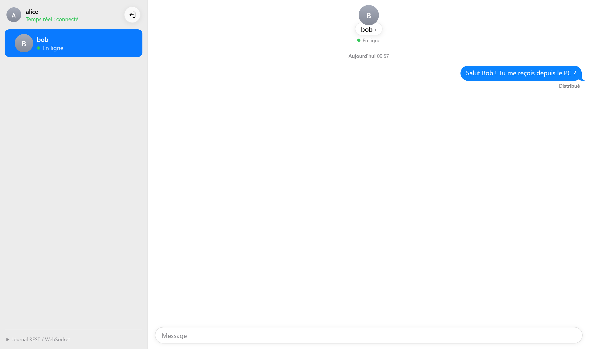
  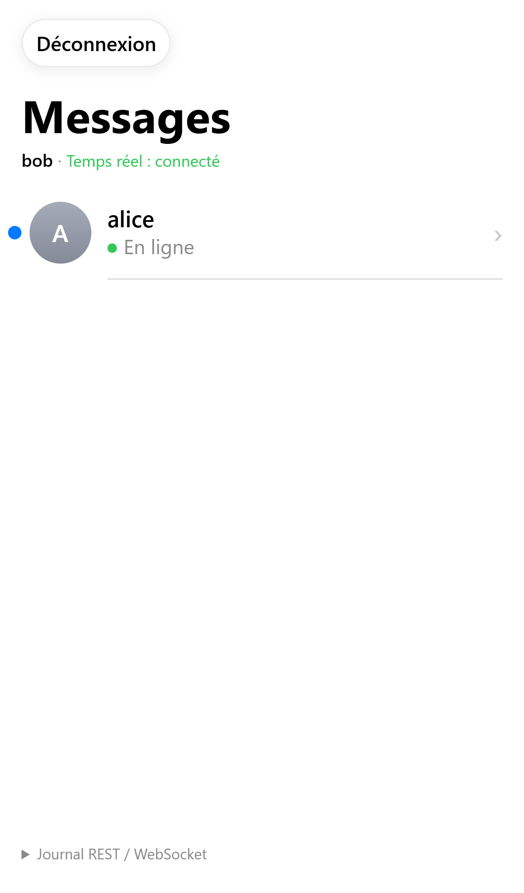
</p>

*Figure 6 : étape 3. Le WebSocket pousse le message d'alice vers bob, qui ne l'a pas encore ouvert (point bleu « non lu »). Chez alice, le statut est « Distribué ».*

<p align="center">
  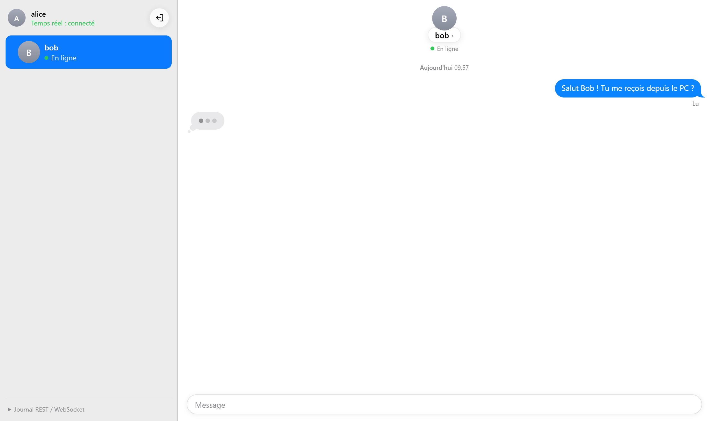
</p>

*Figure 7 : indicateur de saisie (bonus). Pendant que bob tape sa réponse, alice voit la bulle « … » (trames `typing`). Son premier message est passé à « Lu » quand bob a ouvert la conversation.*

<p align="center">
  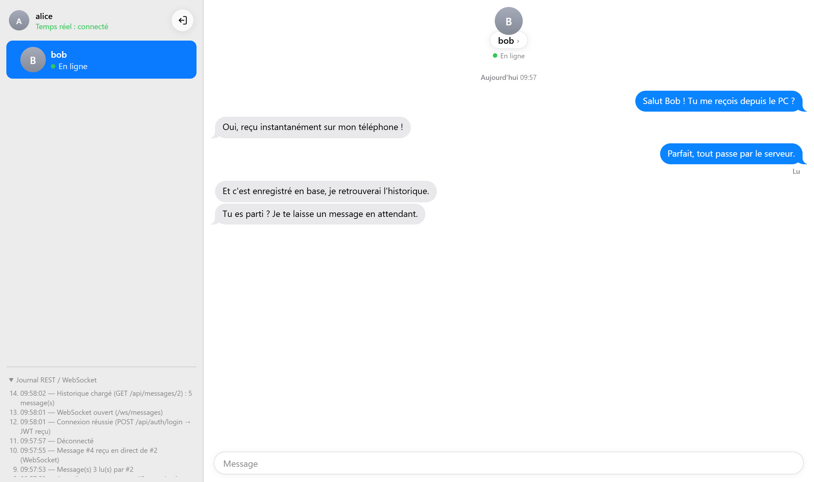
</p>

*Figure 8 : étape 5. Après la déconnexion puis la reconnexion d'alice, `GET /api/messages/2` recharge l'historique complet (5 messages, dont celui reçu hors ligne). Le journal déplié en bas à gauche montre la séquence : login REST, ouverture du WebSocket, historique REST.*

<p align="center">
  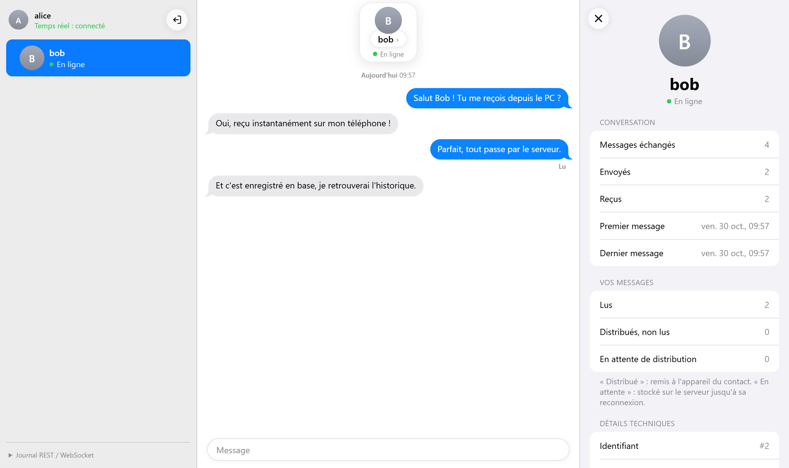
</p>

*Figure 9 : panneau d'informations sur le contact, avec des statistiques calculées à partir de l'historique réel (envoyés, reçus, lus, distribués, en attente) et l'état du canal temps réel.*

<p align="center">
  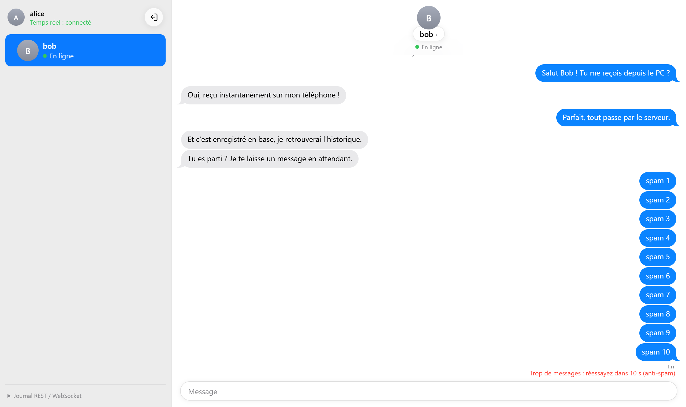
</p>

*Figure 10 : limitation de débit (§3). Sur 11 messages envoyés en rafale, les 10 premiers passent. Le 11ᵉ n'est ni enregistré ni transmis, et le serveur répond `RATE_LIMITED` avec le délai d'attente.*

<p align="center">
  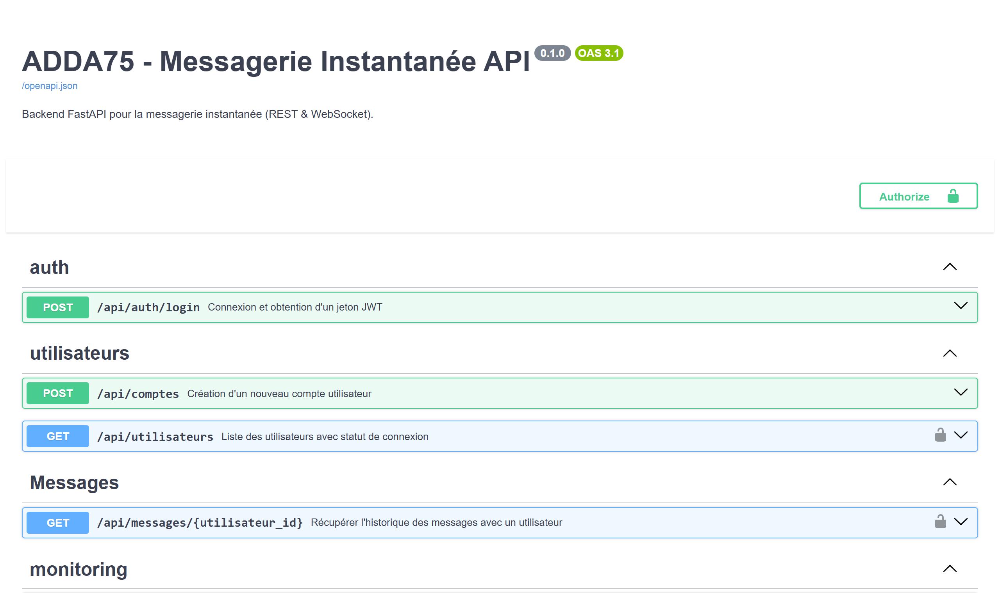
  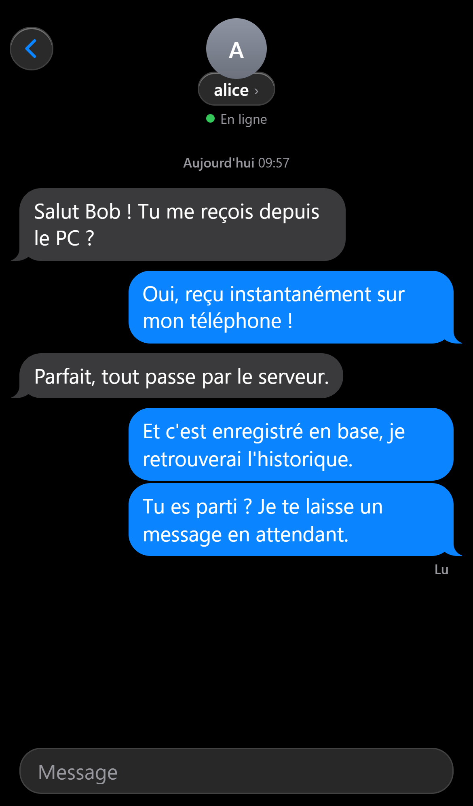
</p>

*Figure 11 : à gauche, la documentation OpenAPI générée par FastAPI (`/docs`), avec le bouton « Authorize » pour le jeton Bearer. À droite, le client mobile en mode sombre.*
